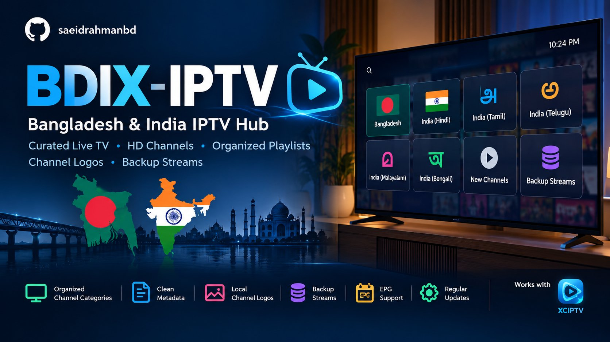

<!-- Project banner -->

  

<h1 align="center">BDIX-IPTV</h1>

  Curated M3U playlists for Bangladesh, India and international movie and music channels.

  
  
  
  

---

## Playlists

| Playlist | Description | Link |
|---|---|---|
| **IPTV Playlist** | Main curated collection, primarily Bangladesh and India | [Open playlist](https://raw.githubusercontent.com/saeidrahmanbd/BDIX-IPTV/main/IPTV-Playlist.m3u) |
| **BDIX Playlist** | BDIX-focused channel collection | [Open playlist](https://raw.githubusercontent.com/saeidrahmanbd/BDIX-IPTV/main/BDIX-Playlist.m3u) |
| **International Playlist** | International movie and music channels, with separate thematic groups | [Open playlist](https://raw.githubusercontent.com/saeidrahmanbd/BDIX-IPTV/main/International-Playlist.m3u) |

## Getting Started

1. Copy the playlist URL from the table above.
2. Open an M3U-compatible player, such as XCIPTV, TiviMate, VLC, IPTV Smarters or Kodi.
3. Add the URL as a remote M3U playlist and refresh the channel list.

The playlists are updated through repository maintenance workflows. Stream availability can vary by provider, location and time.

## Playlist Studio

[**Playlist Studio**](https://github.com/saeidrahmanbd/Playlist-Studio) is a separate Windows application for managing, editing and testing IPTV playlists.

- [Download Playlist Studio v5.0](https://github.com/saeidrahmanbd/Playlist-Studio/releases/download/v5.0.0/Playlist-Studio-5.0.exe)
- [Download the Windows Build Kit](https://github.com/saeidrahmanbd/Playlist-Studio/releases/download/v5.0.0/Playlist-Studio-5_0-Windows-Build-Kit-Debug22.zip)
- [Usage and build guide](docs/PLAYLIST-STUDIO.md)

## Project Resources

- [Documentation](docs/README.md)
- [Download Center](docs/DOWNLOADS.md)
- [Stream Health Report](reports/stream-health.md)
- [Playlist Audit](reports/iptv-playlist-audit.md)
- [Backup Independence Audit](reports/backup-independence-audit.md)
- [Maintenance Report](reports/maintenance-report.md)
- [Project Dashboard](assets/dashboard.svg)

Reports are generated snapshots. Check the timestamp in each report before relying on its findings.

## EPG Status

Public XMLTV/EPG publication is currently disabled while redistribution rights for programme data are reviewed. No public guide is offered until that review is resolved.

## Feedback and Support

To report a broken stream, incorrect metadata or a missing logo, [open an issue](https://github.com/saeidrahmanbd/BDIX-IPTV/issues). Include the channel name, relevant playlist or stream URL, and a short description.

For project-related inquiries, contact [Saeid Rahman](mailto:saeidrahman.mkt@gmail.com) or visit [GitHub profile](https://github.com/saeidrahmanbd).

## Disclaimer

This repository provides playlist references; it does not host television channels or video content. Stream availability and programme information may change without notice. Users are responsible for complying with applicable laws, regulations and service terms.

## License

Repository code and documentation are licensed under the [MIT License](LICENSE), to the extent owned by the maintainer. Third-party logos, names, trademarks, programme data and stream endpoints remain subject to their respective owners' rights and terms.
