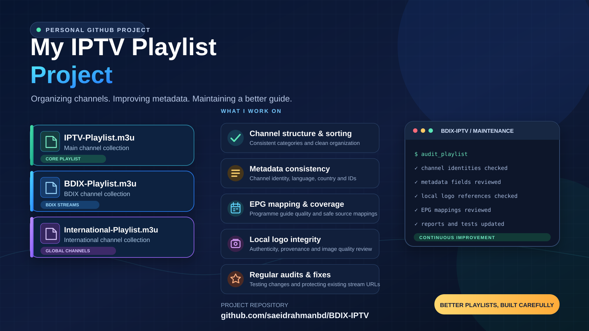
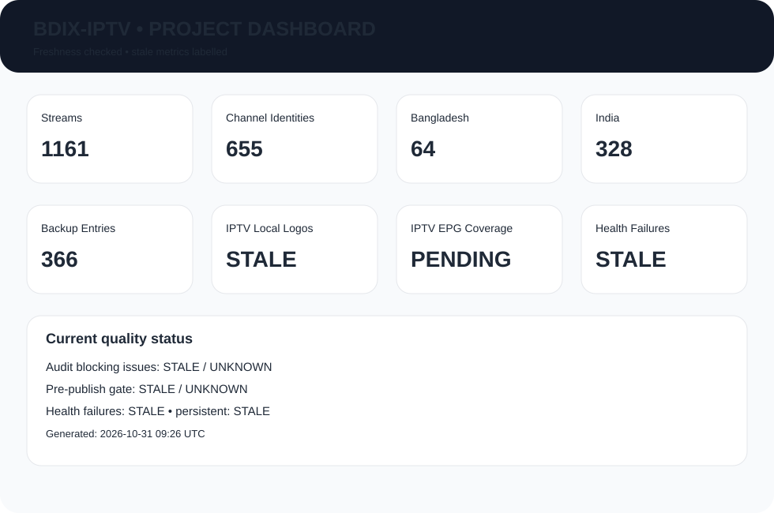
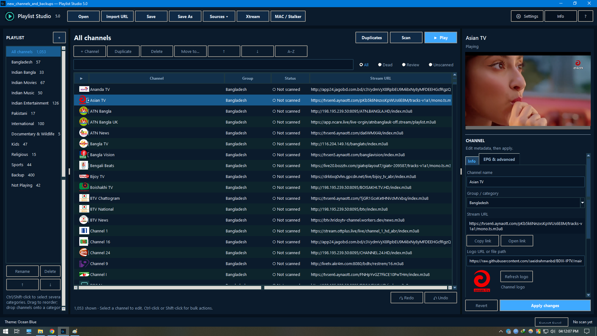

<!-- BDIX-IPTV banner -->
<p align="center">
  
</p>

<h1 align="center">📺 BDIX-IPTV</h1>

<p align="center">
  <b>Bangladesh & India IPTV Hub — Worldwide Channel Collections</b><br>
  Curated M3U playlists, organized categories, local logo assets, EPG mapping tools and automated quality checks.
</p>

<p align="center">
  <a href="https://github.com/saeidrahmanbd/BDIX-IPTV/stargazers"></a>
  <a href="https://github.com/saeidrahmanbd/BDIX-IPTV/network/members"></a>
  <a href="https://github.com/saeidrahmanbd/BDIX-IPTV/issues"></a>
  <a href="https://github.com/saeidrahmanbd/BDIX-IPTV/commits/main"></a>
</p>

<p align="center">
  
  
  
  <a href="https://github.com/saeidrahmanbd/BDIX-IPTV/actions/workflows/iptv-maintenance.yml"></a>
</p>

<p align="center">
  <a href="#-playlists">Playlists</a> ·
  <a href="#-quick-start">Quick Start</a> ·
  <a href="#-epg">EPG</a> ·
  <a href="#-repository-showcase">Showcase</a> ·
  <a href="#-download-center">Downloads</a> ·
  <a href="#-playlist-studio">Playlist Studio</a> ·
  <a href="#-reports-and-status">Reports</a> ·
  <a href="#-support">Support</a>
</p>

---

## ✨ Overview

BDIX-IPTV maintains three M3U playlists for Bangladesh, India, BDIX-focused viewing and international channels, with organized categories, consistent metadata, repository-local logos, duplicate URL checks and reviewed backup references. The XMLTV refresh workflow is enabled; the first successful run must publish the guide before it is available to players.

| 🏷️ Channel Metadata | 🖼️ Logo Assets | 🩺 Stream Review | 🗓️ Programme Guide |
|:---:|:---:|:---:|:---:|
| Names, IDs and groups | Repository-local assets | Health and backup checks | EPG refresh enabled; publish pending |

## 📺 Playlists

| Playlist | Description | Open |
|---|---|:---:|
| **IPTV-Playlist.m3u** | Main curated Bangladesh and India collection | [](https://raw.githubusercontent.com/saeidrahmanbd/BDIX-IPTV/main/IPTV-Playlist.m3u) |
| **BDIX-Playlist.m3u** | BDIX-focused channel collection | [](https://raw.githubusercontent.com/saeidrahmanbd/BDIX-IPTV/main/BDIX-Playlist.m3u) |
| **International-Playlist.m3u** | International movie and music country groups, with separate thematic categories | [](https://raw.githubusercontent.com/saeidrahmanbd/BDIX-IPTV/main/International-Playlist.m3u) |

---

## 🚀 Quick Start

Add a playlist URL to **XCIPTV** or any M3U-compatible player, such as TiviMate, VLC, IPTV Smarters or Kodi.

```text
https://raw.githubusercontent.com/saeidrahmanbd/BDIX-IPTV/main/IPTV-Playlist.m3u
```

<p align="center">
  <a href="https://raw.githubusercontent.com/saeidrahmanbd/BDIX-IPTV/main/IPTV-Playlist.m3u">
    
  </a>
</p>

For another collection, copy its URL from the Playlists table. In your player, choose **Add playlist by M3U URL**, paste the link, save and refresh the channel list.

## 🗓️ EPG

The XMLTV refresh workflow is enabled. All three maintained playlists point to [the target guide URL](https://raw.githubusercontent.com/saeidrahmanbd/BDIX-IPTV/main/epg/epg.xml), and both Xtream workers serve that guide through authenticated `xmltv.php` endpoints. **The guide file is not present yet**; it becomes available only after a refresh run successfully generates, validates, and commits it. EPG.PW remains excluded, private M3U4U URLs are not included in the public build, and the source-rights register transparently lists unresolved upstream reviews. The workflow uses an explicit owner override for review-required (but not prohibited) sources; this does not mean their rights have been independently verified. See the [EPG status page](epg/README.md), [source-rights register](epg/source-rights-register.csv) and [coverage report](reports/epg-coverage.md).

## 🖼️ Repository Showcase

<p align="center">
  <a href="assets/iptv-project-showcase.svg">
    
  </a>
</p>

### Repository Dashboard

<p align="center">
  <a href="assets/dashboard.svg">
    
  </a>
</p>

> The dashboard and linked reports are generated snapshots, not live monitoring pages. Check each report's generation timestamp before relying on its findings.

---

## 📥 Download Center

| Resource | Description |
|---|---|
| [Main IPTV Playlist](https://raw.githubusercontent.com/saeidrahmanbd/BDIX-IPTV/main/IPTV-Playlist.m3u) | Main curated collection |
| [BDIX Playlist](https://raw.githubusercontent.com/saeidrahmanbd/BDIX-IPTV/main/BDIX-Playlist.m3u) | BDIX-focused collection |
| [International Playlist](https://raw.githubusercontent.com/saeidrahmanbd/BDIX-IPTV/main/International-Playlist.m3u) | International movie/music and thematic groups |
| [Public EPG (XMLTV)](https://raw.githubusercontent.com/saeidrahmanbd/BDIX-IPTV/main/epg/epg.xml) | Target programme guide; available after a successful refresh run |\n| [EPG Publication Status](reports/epg-coverage.md) | Current publication state; historical mappings are not live coverage |
| [Playlist Studio 5.0](https://github.com/saeidrahmanbd/Playlist-Studio/releases/download/v5.0.0/Playlist-Studio-5.0.exe) | Windows playlist manager, editor and player |
| [Playlist Studio Windows Build Kit](https://github.com/saeidrahmanbd/Playlist-Studio/releases/download/v5.0.0/Playlist-Studio-5_0-Windows-Build-Kit-Debug22.zip) | Windows build package |
| [Xtream Gateway documentation](xtream/README.md) | Optional Xtream-compatible access details |
| [Full Download Center](docs/DOWNLOADS.md) | All key downloads and documentation |
| [Documentation index](docs/README.md) | Project guides and references |

---

## 🖥️ Playlist Studio

[**Playlist Studio 5.0**](https://github.com/saeidrahmanbd/Playlist-Studio) is a separate Windows application for managing, editing, testing and playing IPTV playlists.

<p align="center">
  <a href="assets/playlist-studio-5.png">
    
  </a>
</p>

**Key features**
- ✏️ M3U / M3U8 playlist editing and category organization
- 🏷️ Channel metadata, logo, EPG and stream URL editing
- 🔍 Stream scanning, duplicate detection and built-in playback
- 🔌 Xtream Codes and MAC / Stalker Portal support
- 🐙 GitHub integration and Save / Save As

<p align="center">
  <a href="https://github.com/saeidrahmanbd/Playlist-Studio/releases/download/v5.0.0/Playlist-Studio-5.0.exe"></a>
  <a href="https://github.com/saeidrahmanbd/Playlist-Studio/releases/download/v5.0.0/Playlist-Studio-5_0-Windows-Build-Kit-Debug22.zip"></a>
  <a href="docs/PLAYLIST-STUDIO.md"></a>
</p>

---

## 📊 Reports and Status

Automated workflows generate playlist audits, maintenance summaries and stream-health reports. Endpoint failures can reflect provider authentication, entitlement or geographic restrictions, so a failed check is a review signal, not proof that a stream is unavailable to everyone.

| Report | Purpose |
|---|---|
| [Project Dashboard](assets/dashboard.svg) | Playlist inventory and EPG publication status |
| [IPTV Playlist Audit](reports/iptv-playlist-audit.md) | Duplicate URLs, identity and metadata checks |
| [IPTV Channel Discovery](reports/iptv-channel-discovery.md) | Discovered Bangladesh and India channel candidates |
| [Stream Health](reports/stream-health.md) | Endpoint checks and failure classification |
| [Backup Independence Audit](reports/backup-independence-audit.md) | Review of backup stream and infrastructure independence |
| [Maintenance Report](reports/maintenance-report.md) | Automated maintenance summary |
| [Update Report](reports/Update%20Report.md) | Latest generated update snapshot |
| [Stream Risk Review](reports/stream-risk-review.md) | Stream references flagged for additional review |
| [EPG Coverage](reports/epg-coverage.md) | Programme-guide coverage and publication status |

### Maintenance principles

- Keep channel names, IDs, groups and logo references consistent.
- Avoid duplicate stream URLs and use local logo assets in published playlists.
- Protect primary entries and backup references from indiscriminate automatic deletion.
- Treat new channels and backups as candidates for review.
- Check report timestamps before treating generated metrics as current.

---

## 📦 Delivery and Rollback

Playlists and logo assets are served from the `main` branch through GitHub raw-content URLs, so updates can become visible as soon as changes are committed. EPG data is generated by the enabled refresh workflow and published only after its validation gates pass. For a reproducible snapshot, use a reviewed commit-specific URL where supported. Git history provides rollback points.

## 🤝 Support

Found a broken stream, incorrect channel information or a missing logo? [Open an issue](https://github.com/saeidrahmanbd/BDIX-IPTV/issues) with the channel name, playlist or stream URL, and a short description. You can also join [GitHub Discussions](https://github.com/saeidrahmanbd/BDIX-IPTV/discussions).

## 📬 Contact

<p align="center">
  <a href="mailto:saeidrahman.mkt@gmail.com"></a>
  <a href="https://github.com/saeidrahmanbd"></a>
  <a href="https://www.facebook.com/saeid.rahman.sr"></a>
</p>

---

## 📄 License

Repository code and documentation are licensed under the [MIT License](LICENSE), to the extent owned by the maintainer. Third-party logos, names, trademarks, programme data, stream endpoints and other third-party content remain subject to their respective owners' rights and terms.

## ⚠️ Disclaimer

This repository provides references to streams; it does not host television channels or video content. Availability and programme information may change without notice. Users are responsible for complying with applicable laws, regulations and service terms.

<p align="center">
  ⭐ <b>If you find the project useful, consider starring the repository.</b><br><br>
  <a href="https://github.com/saeidrahmanbd/BDIX-IPTV">github.com/saeidrahmanbd/BDIX-IPTV</a><br><br>
  <sub>Made with ❤️ by <a href="https://github.com/saeidrahmanbd">Saeid Rahman</a></sub>
</p>
