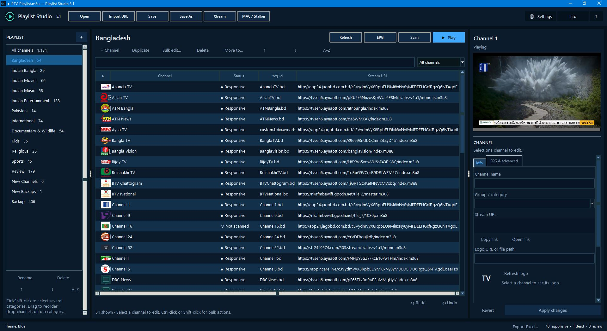

<h1 align="center">BDIX-IPTV: Bangladesh IPTV M3U/M3U8 Playlists &amp; XMLTV EPG</h1>

<p align="center">
  <strong>A curated, regularly maintained Bangladesh IPTV and multi-country M3U/M3U8 playlist collection featuring Bangla TV, Indian, Pakistani and eligible international channels, with organized groups, local channel logos, alternate streams and an XMLTV EPG.</strong><br>
  <sub>Compatible with XCIPTV, TiviMate, OTT Navigator, IPTV Smarters, VLC, Kodi and other M3U-compatible players.</sub>
</p>

<p align="center">
  <a href="https://saeidrahmanbd.github.io/BDIX-IPTV/"></a>
</p>

<p align="center">
  <a href="https://github.com/saeidrahmanbd/BDIX-IPTV/stargazers"></a>
  <a href="https://github.com/saeidrahmanbd/BDIX-IPTV/network/members"></a>
  <a href="https://github.com/saeidrahmanbd/BDIX-IPTV/commits/main"></a>
  <a href="LICENSE"></a>
</p>

<p align="center">
  
  
  
  <a href="https://github.com/saeidrahmanbd/BDIX-IPTV/actions/workflows/iptv-maintenance.yml"></a>
</p>

<p align="center">
  <a href="https://saeidrahmanbd.github.io/BDIX-IPTV/"><strong>🌐 Project Website</strong></a> ·
  <a href="https://saeidrahmanbd.github.io/BDIX-IPTV/playlists.html"><strong>📖 Playlist Guide</strong></a> ·
  <a href="https://saeidrahmanbd.github.io/BDIX-IPTV/bangla-iptv.html" lang="bn"><strong>🇧🇩 বাংলা IPTV</strong></a> ·
  <a href="#playlists"><strong>📺 Playlists</strong></a> ·
  <a href="#epg"><strong>🗓️ EPG</strong></a> ·
  <a href="#playlist-studio"><strong>🖥️ Playlist Studio</strong></a> ·
  <a href="#contact"><strong>📞 Contact</strong></a>
</p>

---

## About BDIX-IPTV

**BDIX-IPTV** provides Bangladesh IPTV and multi-country M3U/M3U8 playlists for Bangla TV, Indian, Pakistani and eligible international channels. The main **IPTV-Playlist.m3u** is the broad collection, organized into country and genre groups. The companion **International-Playlist.m3u** provides a separate international selection.

The playlists are maintained with organized channel groups, channel information and locally stored logo assets where available. A shared **XMLTV Electronic Programme Guide (EPG)** is also provided for compatible IPTV players. Automated workflows support channel discovery, playlist maintenance, stream checks and EPG updates.

Stream availability and programme-guide coverage depend on third-party sources and may change over time.

---

<a id="playlists"></a>
## 📺 Choose Your IPTV Playlist

<table>
  <tr>
    <td align="center" width="50%" valign="top">
      <h2>🌏</h2>
      <h3>Multi-Country IPTV</h3>
      <p><strong>IPTV-Playlist.m3u</strong></p>
      <p>The main multi-country collection, covering Bangladesh, India, Pakistan and eligible channels from other countries across organized country and genre groups.</p>
      <a href="https://raw.githubusercontent.com/saeidrahmanbd/BDIX-IPTV/main/IPTV-Playlist.m3u"></a>
      <br><br><a href="https://github.com/saeidrahmanbd/BDIX-IPTV/blob/main/IPTV-Playlist.m3u">View playlist source</a>
    </td>
    <td align="center" width="50%" valign="top">
      <h2>🌍</h2>
      <h3>International IPTV</h3>
      <p><strong>International-Playlist.m3u</strong></p>
      <p>A broader collection featuring Bangladesh and India, alongside eligible movie and music channels from other countries.</p>
      <a href="https://raw.githubusercontent.com/saeidrahmanbd/BDIX-IPTV/main/International-Playlist.m3u"></a>
      <br><br><a href="https://github.com/saeidrahmanbd/BDIX-IPTV/blob/main/International-Playlist.m3u">View playlist source</a>
    </td>
  </tr>
</table>

### Copy playlist URLs

**Main playlist — Multi-Country IPTV**
```text
https://raw.githubusercontent.com/saeidrahmanbd/BDIX-IPTV/main/IPTV-Playlist.m3u
```

**International companion playlist**
```text
https://raw.githubusercontent.com/saeidrahmanbd/BDIX-IPTV/main/International-Playlist.m3u
```

### 📱 Compatible IPTV Players

The M3U playlists can be used with applications supporting remote playlist URLs, including XCIPTV, TiviMate, OTT Navigator, IPTV Smarters, VLC and Kodi.

**How to add a playlist:** Copy the M3U URL, open your IPTV player, choose **Add Playlist by URL**, paste the link and refresh the channel list. Menu names may differ between applications.

---

<a id="epg"></a>
## 🗓️ XMLTV EPG – TV Programme Guide

Both playlists use a shared **XMLTV Electronic Programme Guide (EPG)**. Add the following URL in your player's **EPG** or **XMLTV** settings:

```text
https://raw.githubusercontent.com/saeidrahmanbd/BDIX-IPTV/main/epg/epg.xml
```

The guide is maintained through automated channel mapping, schedule collection and validation before publication. Coverage varies by channel and source availability.

---

<a id="playlist-studio"></a>
## 🖥️ Playlist Studio 5.1 for Windows

**Playlist Studio 5.1** is the Windows playlist manager, editor, EPG tool and player maintained with this project. It manages, organizes, edits, tests and plays M3U/M3U8 playlists from one workspace.

<p align="center">
  <a href="https://github.com/saeidrahmanbd/BDIX-IPTV/releases/tag/v5.1"></a>
</p>

### What's new in 5.1

- **EPG Centre:** Load multiple XMLTV guides from URLs or local XML, GZ, XZ and ZIP files; review guide coverage, statuses and Now/Next.
- **EPG editing:** Search, sort and edit `tvg-id` values, preview bulk metadata edits and undo; manual EPG corrections persist through refreshes and re-imports.
- **Smarter stream scanner:** Responsive, Dead, Unreachable, Restricted, Stale, Unavailable, Unverified and Error statuses; timeouts and blocked requests are not automatically marked Dead.
- **Scan controls:** Pause, resume and cancel; configure limits, timeouts, retries and player identity; scan selected channels, a category or the current view; optional HLS freshness and deep diagnostics.
- **Persistent review history:** Good, Bad and Review verdicts, notes and scan history are retained between sessions; a new scan does not overwrite your verdict.
- **Xtream and Stalker:** Background login/import with cancellation; Xtream can fall back to M3U download; Stalker imports are undoable.
- **Credential protection:** Remembered provider logins are protected with Windows DPAPI; credentials can be masked in the channel list.
- **Safer playlist handling:** UTF-8 saving, preservation of directives/comments/unknown header keys, safer backups, autosave/recovery and malformed-line import repair.

### Portable application

No traditional installation is required. Download the portable EXE and run it on 64-bit Windows. VLC playback is bundled.

<p align="center">
  <a href="https://github.com/saeidrahmanbd/BDIX-IPTV/releases/download/v5.1/Playlist-Studio-5.1.exe"></a>
  <a href="https://github.com/saeidrahmanbd/BDIX-IPTV/releases/tag/v5.1"></a>
</p>

> **Windows SmartScreen:** Windows may warn because the executable is unsigned. Download only from this official release. If you trust the source, choose **More info → Run anyway**.

### Windows Build Kit r2

The release includes **Playlist-Studio-5_1-Windows-Build-Kit-r2.zip**. It creates an isolated build environment, installs pinned dependencies, runs automated tests, bundles VLC with checksum verification and builds the portable EXE.

**Build requirements:** Windows 10/11 x64 and 64-bit Python 3.10–3.13 (Python 3.13 recommended). Python 3.14 and 3.15 are not supported by the current pinned PyInstaller dependency set. Newer Python installations can remain installed alongside Python 3.13.

1. Download and extract the [Windows Build Kit r2](https://github.com/saeidrahmanbd/BDIX-IPTV/releases/download/v5.1/Playlist-Studio-5_1-Windows-Build-Kit-r2.zip).
2. Run `BUILD-WINDOWS.cmd`.
3. Wait for **BUILD COMPLETE**.
4. Run `Playlist-Studio-5.1.exe` from the build kit folder.

**No Python Launcher?** The Python Launcher is recommended but not required. Set `PS_PYTHON` to the full path of a compatible Python executable and run the builder in the same Command Prompt session. Example (adjust paths):

```cmd
set "PS_PYTHON=C:\Program Files\Python313\python.exe"
cd /d "D:\Software\Playlist-Studio-5_1-Windows-Build-Kit-r2"
BUILD-WINDOWS.cmd --fresh
```

The `--fresh` option recreates the kit's `.venv-build` environment. `PS_PYTHON` applies only to that Command Prompt session. If a build step fails, inspect `BUILD-LOG.txt` beside the builder. The ZIP includes its own README and known-limitations notes.

### Release details

| Item | Details |
|---|---|
| Release | [Playlist Studio v5.1](https://github.com/saeidrahmanbd/BDIX-IPTV/releases/tag/v5.1) |
| Platform | Windows 10 / 11, x64 |
| Edition | Portable EXE |
| Playlist formats | M3U / M3U8 |
| EPG | XMLTV from URLs and local files |
| Playback | Built-in player with bundled VLC |
| Build Python | 3.13 recommended; 3.10–3.13 accepted |

See the [feature guide](docs/PLAYLIST-STUDIO.md) and [release integrity record](docs/PLAYLIST-STUDIO-INTEGRITY.md).

---

<a id="support"></a>
## 📬 Support

Found a broken stream, incorrect information, a missing logo or another issue?

<p align="center">
  <a href="https://github.com/saeidrahmanbd/BDIX-IPTV/issues"></a>
  <a href="https://github.com/saeidrahmanbd/BDIX-IPTV/discussions"></a>
</p>

> 📝 When reporting a stream issue, include the **channel name, playlist name, stream URL and a short description** whenever possible.

---

<a id="contact"></a>
## 📞 Contact

For collaboration, feedback, IPTV playlist issues or project-related inquiries, contact the maintainer through the channels below.

<p align="center">
  <a href="mailto:saeidrahman.mkt@gmail.com"></a>
  <a href="https://github.com/saeidrahmanbd"></a>
  <a href="https://www.facebook.com/saeid.rahman.sr"></a>
</p>

---

## 📄 License &amp; Disclaimer

The repository's original code and documentation are licensed under the [MIT License](LICENSE), to the extent owned by the maintainer. The license does not cover third-party broadcaster logos, names, trademarks, programme data or stream endpoints; those remain subject to their respective owners' rights.

> ⚠️ This repository does not host television channels, broadcast signals or video content. It provides references to streams and related playlist information. Stream availability and programme data may change without notice. Users are responsible for complying with applicable laws, regulations, broadcaster rights and service terms.

---

<hr>

<p align="center">
  <strong>⭐ If you find this project useful, please consider starring it on GitHub!</strong>
  <br><br>
  <a href="https://github.com/saeidrahmanbd/BDIX-IPTV"></a>
  <br>
  <sub>Click the badge to visit the repository, then click GitHub's Star button.</sub>
  <br><br>
  <a href="https://github.com/saeidrahmanbd/BDIX-IPTV"><strong>github.com/saeidrahmanbd/BDIX-IPTV</strong></a>
  <br><br>
  Developed and maintained with ❤️ by <a href="https://github.com/saeidrahmanbd"><strong>Saeid Rahman</strong></a>
</p>