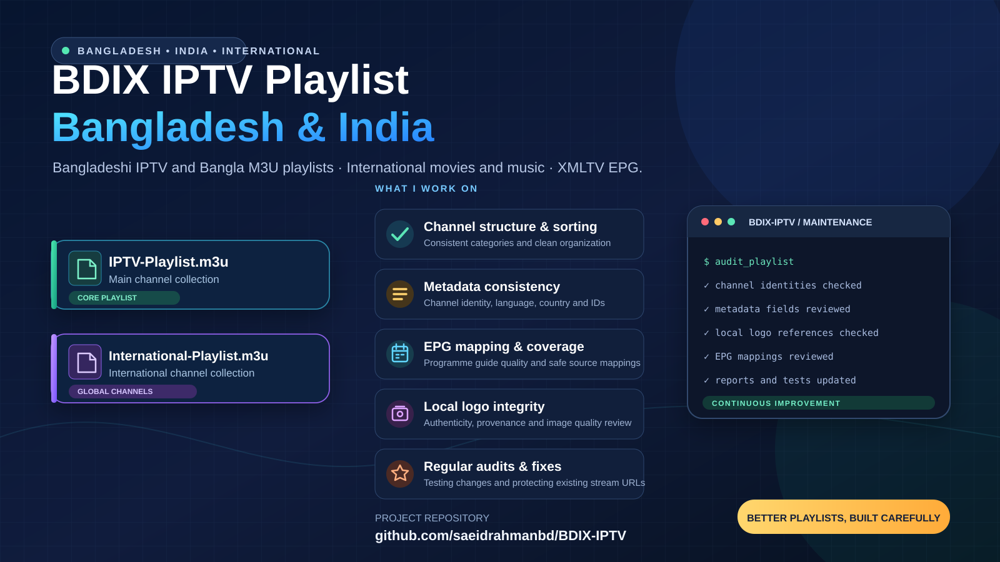
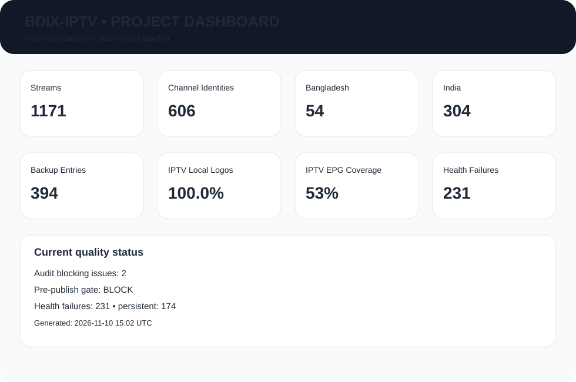
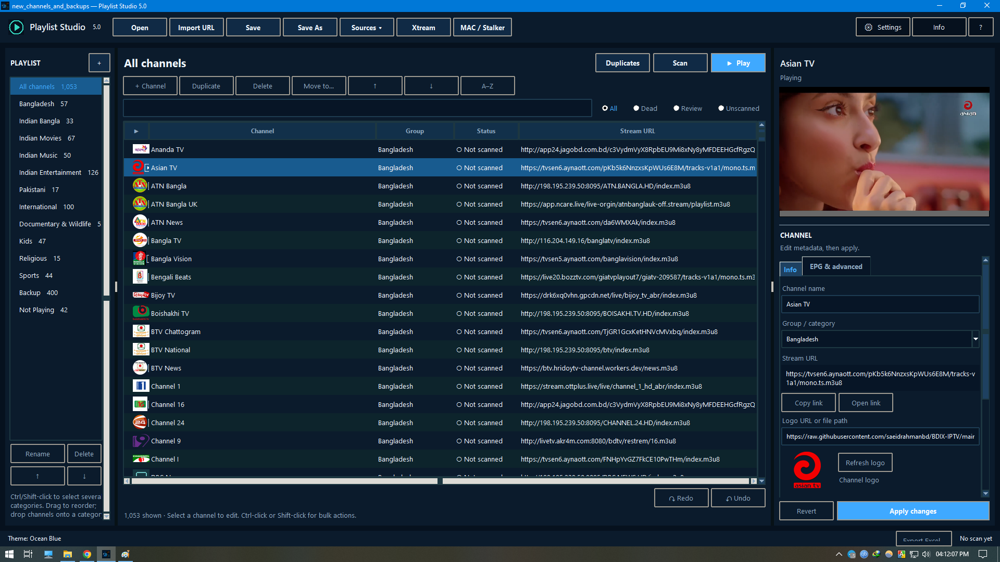

<h1 align="center">📺 BDIX-IPTV</h1>

<p align="center">
  <b>Bangladesh &amp; India IPTV Hub — Worldwide Channel Collections</b><br>
  Curated M3U playlists · organized categories · local logo assets · EPG mapping tools · automated quality checks
</p>

<p align="center">
  <a href="https://github.com/saeidrahmanbd/BDIX-IPTV/stargazers"></a>
  <a href="https://github.com/saeidrahmanbd/BDIX-IPTV/network/members"></a>
  <a href="https://github.com/saeidrahmanbd/BDIX-IPTV/issues"></a>
  <a href="https://github.com/saeidrahmanbd/BDIX-IPTV/commits/main"></a>
  <a href="LICENSE"></a>
</p>

<p align="center">
  
  
  
  <a href="https://github.com/saeidrahmanbd/BDIX-IPTV/actions/workflows/iptv-maintenance.yml"></a>
</p>

<p align="center">
  <a href="#playlists"><b>📺 Playlists</b></a> &nbsp;·&nbsp;
  <a href="#quick-start"><b>🚀 Quick Start</b></a> &nbsp;·&nbsp;
  <a href="#epg"><b>🗓️ EPG</b></a> &nbsp;·&nbsp;
  <a href="#repository-showcase"><b>🖼️ Showcase</b></a> &nbsp;·&nbsp;
  <a href="#download-center"><b>📥 Downloads</b></a> &nbsp;·&nbsp;
  <a href="#playlist-studio"><b>🖥️ Studio</b></a> &nbsp;·&nbsp;
  <a href="#reports-and-status"><b>📊 Reports</b></a> &nbsp;·&nbsp;
  <a href="#support"><b>📬 Support</b></a>
</p>

---

<a id="overview"></a>
## ✨ Overview

BDIX-IPTV maintains two M3U playlists for Bangladesh, India and international channels. Every list uses organized categories, consistent metadata, repository-local logos, duplicate URL checks and reviewed backup references. The XMLTV refresh workflow is enabled and the public guide is published at the repository EPG endpoint.

<table align="center">
  <tr>
    <td align="center" width="25%"><h3>🏷️</h3><b>Channel Metadata</b><br><sub>Names, IDs and groups</sub></td>
    <td align="center" width="25%"><h3>🖼️</h3><b>Logo Assets</b><br><sub>Repository-local assets</sub></td>
    <td align="center" width="25%"><h3>🩺</h3><b>Stream Review</b><br><sub>Health and backup checks</sub></td>
    <td align="center" width="25%"><h3>🗓️</h3><b>Programme Guide</b><br><sub>EPG refresh enabled and published</sub></td>
  </tr>
</table>

---

<a id="playlists"></a>
## 📺 Playlists

| | Playlist | Description | Open |
|:---:|---|---|:---:|
| 🇧🇩🇮🇳 | **IPTV-Playlist.m3u** | Main curated Bangladesh and India collection | [](https://raw.githubusercontent.com/saeidrahmanbd/BDIX-IPTV/main/IPTV-Playlist.m3u) |
| 🌍 | **International-Playlist.m3u** | International movie and music country groups, with separate thematic categories | [](https://raw.githubusercontent.com/saeidrahmanbd/BDIX-IPTV/main/International-Playlist.m3u) |

---

<a id="quick-start"></a>
## 🚀 Quick Start

**1.** Copy a playlist URL.&nbsp; **2.** In your player choose **Add playlist by M3U URL**.&nbsp; **3.** Paste, save and refresh the channel list.

Works with **XCIPTV** and any M3U-compatible player, such as TiviMate, VLC, IPTV Smarters or Kodi.

<details open>
<summary><b>📋 Copy-ready playlist URLs</b></summary>

<br>

**Main — IPTV-Playlist.m3u**

```text
https://raw.githubusercontent.com/saeidrahmanbd/BDIX-IPTV/main/IPTV-Playlist.m3u
```

**International — International-Playlist.m3u**

```text
https://raw.githubusercontent.com/saeidrahmanbd/BDIX-IPTV/main/International-Playlist.m3u
```

</details>

<p align="center">
  <a href="https://raw.githubusercontent.com/saeidrahmanbd/BDIX-IPTV/main/IPTV-Playlist.m3u">
    
  </a>
</p>

---

<a id="epg"></a>
## 🗓️ EPG

The XMLTV refresh workflow is enabled and the public guide is published at the URL below. Both maintained playlists and the main Xtream gateway use this guide.

```text
https://raw.githubusercontent.com/saeidrahmanbd/BDIX-IPTV/main/epg/epg.xml
```

| Step | What happens |
|:---:|---|
| 🔎 | Combines useful public and accessible XMLTV/EPG sources |
| 🧭 | Expands channel mappings across the maintained playlists |
| ♻️ | Deduplicates schedules and prefers the strongest current match |
| ✅ | Applies freshness and quality checks |
| 🚀 | Publishes only validated XMLTV data |

> Source-review metadata is advisory, not a build or publication gate.

📚 See the [EPG status page](epg/README.md), [mapping CSV](reports/epg-channel-mapping.csv), [coverage report](reports/epg-coverage.md) and [published-playlist audit](reports/epg-playlist-audit.md).

---

<a id="analytics"></a>
## 📊 IPTV Usage Analytics

A privacy-conscious analytics gateway is available for playlist requests. Once deployed, it provides request totals, daily unique-client estimates and separate usage for each playlist.

- [Analytics setup and deployment guide](analytics/README.md)
- [Worker source](analytics/worker.js)
- [D1 database schema](analytics/schema.sql)

> Analytics only counts playlist fetches routed through the Worker. Direct `raw.githubusercontent.com` links bypass tracking, and playlist requests do not prove that channels were watched. The gateway does not store raw IP addresses.

**Deployment target URLs** (usable after the deployment workflow passes):
- [Analytics dashboard](https://bdix-iptv-analytics.saeidrahman.workers.dev/)
- [Main tracked playlist](https://bdix-iptv-analytics.saeidrahman.workers.dev/main.m3u)
- [International tracked playlist](https://bdix-iptv-analytics.saeidrahman.workers.dev/international.m3u)
- [Deployment workflow status](https://github.com/saeidrahmanbd/BDIX-IPTV/actions/workflows/deploy-analytics.yml)

Keep the existing Raw GitHub playlist URLs as direct fallbacks. Do not switch player configurations until the deployment has passed its endpoint verification.

---

<a id="reports-and-status"></a>
## 📊 Reports and Status

| Report | What it shows |
|---|---|
| [📈 EPG Coverage & Mapping Report](reports/epg-coverage.md) | Current EPG mapping and usable schedule coverage across the maintained playlists |
| [🧾 Published Playlist EPG Audit](reports/epg-playlist-audit.md) | Per-playlist EPG publication, mapped IDs, and schedule availability |
| [🗂️ EPG Channel Mapping CSV](reports/epg-channel-mapping.csv) | Channel-by-channel EPG mapping status and source details |
| [📘 EPG documentation](epg/README.md) | Public guide URL, pipeline, validation, and source policy |

> ℹ️ Reports are generated snapshots. Check each report's generation timestamp before relying on its findings.

---

<a id="repository-showcase"></a>
## 🖼️ Repository Showcase

<p align="center">
  <a href="assets/iptv-project-showcase.svg">
    
  </a>
</p>

### 📟 Repository Dashboard

<p align="center">
  <a href="assets/dashboard.svg">
    
  </a>
</p>

> The dashboard and linked reports are generated snapshots, not live monitoring pages. Check each report's generation timestamp before relying on its findings.

---

<a id="download-center"></a>
## 📥 Download Center

| | Resource | Description |
|:---:|---|---|
| 📺 | [Main IPTV Playlist](https://raw.githubusercontent.com/saeidrahmanbd/BDIX-IPTV/main/IPTV-Playlist.m3u) | Main curated collection |
| 🌍 | [International Playlist](https://raw.githubusercontent.com/saeidrahmanbd/BDIX-IPTV/main/International-Playlist.m3u) | International movie/music and thematic groups |
| 🗓️ | [Public EPG (XMLTV)](https://raw.githubusercontent.com/saeidrahmanbd/BDIX-IPTV/main/epg/epg.xml) | Published programme guide |
| 📈 | [EPG Publication Status](reports/epg-coverage.md) | Current publication state and coverage |
| 🖥️ | [Playlist Studio 5.0](https://github.com/saeidrahmanbd/Playlist-Studio/releases/download/v5.0.0/Playlist-Studio-5.0.exe) | Windows playlist manager, editor and player |
| 🧰 | [Playlist Studio Windows Build Kit](https://github.com/saeidrahmanbd/Playlist-Studio/releases/download/v5.0.0/Playlist-Studio-5_0-Windows-Build-Kit-Debug22.zip) | Windows build package |
| 🔌 | [Xtream Gateway documentation](xtream/README.md) | Optional Xtream-compatible access details |
| 📦 | [Full Download Center](docs/DOWNLOADS.md) | All key downloads and documentation |
| 📚 | [Documentation index](docs/README.md) | Project guides and references |

---

<a id="playlist-studio"></a>
## 🖥️ Playlist Studio

[**Playlist Studio 5.0**](https://github.com/saeidrahmanbd/Playlist-Studio) is a separate Windows application for managing, editing, testing and playing IPTV playlists.

<p align="center">
  
</p>

<p align="center">
  <a href="https://github.com/saeidrahmanbd/Playlist-Studio/releases/download/v5.0.0/Playlist-Studio-5.0.exe"></a>
</p>

---

<a id="support"></a>
## 📬 Support

Found a broken stream, incorrect information, missing logo, or another issue?

<p align="center">
  <a href="https://github.com/saeidrahmanbd/BDIX-IPTV/issues"></a>
  <a href="https://github.com/saeidrahmanbd/BDIX-IPTV/discussions"></a>
</p>

> 📝 For stream reports, include the **channel name, stream/playlist URL, and a short description** when possible.

---

<a id="contact"></a>
## 📞 Contact

For collaboration, feedback, IPTV playlist issues, or project-related inquiries:

<p align="center">
  <a href="mailto:saeidrahman.mkt@gmail.com"></a>
  <a href="https://github.com/saeidrahmanbd"></a>
  <a href="https://www.facebook.com/saeid.rahman.sr"></a>
</p>

---

<a id="license"></a>
## 📄 License

The repository's original code and documentation are licensed under the [MIT License](LICENSE), to the extent owned by the maintainer. The license does **not** relicense third-party broadcaster logos, names, trademarks, programme data, stream endpoints, or other third-party content; those remain subject to their respective owners' rights and terms. Many logo assets are still under authenticity review, so local storage does not imply official verification.

## ⚠️ Disclaimer

> This repository does not host television channels or video content. It contains references to publicly available streams. Availability and programme information may change without notice.
>
> Users are responsible for complying with applicable laws, regulations, and service terms.

---

<p align="center">
  ⭐ <b>If you find the project useful, please star the repository!</b><br><br>
  <a href="https://github.com/saeidrahmanbd/BDIX-IPTV">github.com/saeidrahmanbd/BDIX-IPTV</a><br><br>
  <sub>Made with ❤️ by <a href="https://github.com/saeidrahmanbd">Saeid Rahman</a></sub>
</p>
