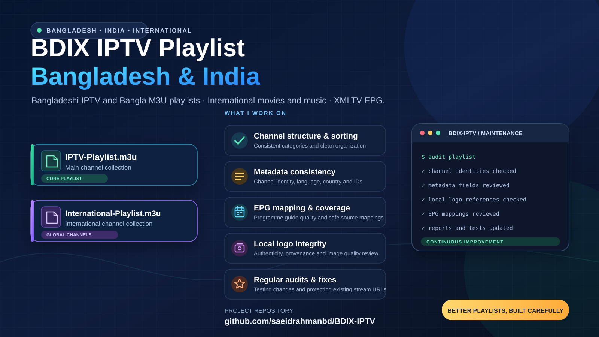
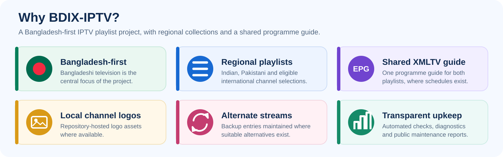
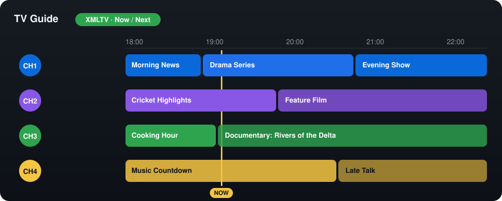
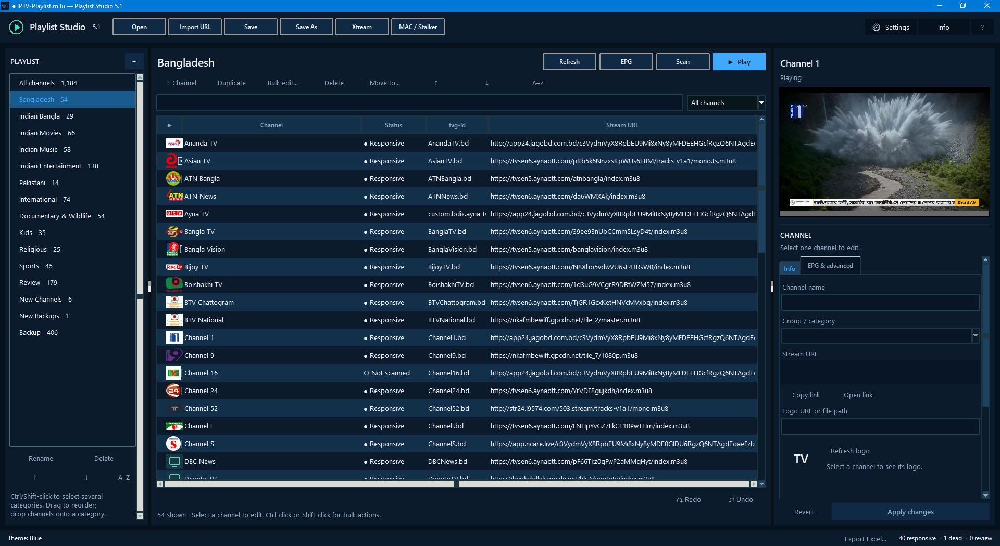

 <div align="center">


# BDIX-IPTV

### Bangladeshi IPTV Platform · Regional M3U/M3U8 Playlists · Shared XMLTV EPG

**A Bangladeshi IPTV IPTV playlist platform — bringing Bangladeshi television together with Indian, Pakistani and international channel collections, supported by one shared XMLTV Electronic Programme Guide.**

Built around Bangladeshi television, BDIX-IPTV brings together curated M3U/M3U8 playlists, organized regional channel groups, locally maintained logos, alternate streams and a shared programme guide for compatible IPTV players.


<a href="https://raw.githubusercontent.com/saeidrahmanbd/BDIX-IPTV/main/IPTV-Playlist.m3u"></a>
<a href="https://raw.githubusercontent.com/saeidrahmanbd/BDIX-IPTV/main/International-Playlist.m3u"></a>
<a href="https://raw.githubusercontent.com/saeidrahmanbd/BDIX-IPTV/main/epg/epg.xml"></a>

[🌐 Project Website](https://saeidrahmanbd.github.io/BDIX-IPTV/) ·
[📖 Playlist Guide](https://saeidrahmanbd.github.io/BDIX-IPTV/playlists.html) ·
[🇧🇩 বাংলা গাইড](https://saeidrahmanbd.github.io/BDIX-IPTV/bangla-iptv.html) ·
[❓ FAQ](#-frequently-asked-questions)

[](https://github.com/saeidrahmanbd/BDIX-IPTV/stargazers) [](https://github.com/saeidrahmanbd/BDIX-IPTV/commits/main)

</div>

---

## 📺 About BDIX-IPTV

**BDIX-IPTV is a Bangladeshi IPTV IPTV playlist platform.** It puts Bangladeshi television at the centre, with additional Indian, Pakistani and international channel collections for viewers who want a broader selection.

The project provides publicly accessible M3U/M3U8 playlists and a shared XMLTV Electronic Programme Guide (EPG) for compatible IPTV applications.

Whether you are looking for Bangladeshi television first or want to explore Indian, Pakistani and international selections, BDIX-IPTV provides organized playlist collections and a shared XMLTV EPG for compatible IPTV players.

<div align="center">

</div>

<div align="center">



</div>

Bangladeshi channels are a key part of the project, alongside Indian, Pakistani and international selections. One shared XMLTV guide helps compatible IPTV players display available programme schedules.

> **Note:** Channel availability, stream functionality and programme schedules depend on external sources. A listed channel does not guarantee uninterrupted playback or available EPG data.

---

## 🚀 Quick Start — Start Using BDIX-IPTV

Getting started requires a compatible IPTV player and a playlist URL.

<div align="center">


</div>

1. **Choose a playlist:** Select your preferred collection from [Choose Your IPTV Playlist](#-choose-your-iptv-playlist).
2. **Add the playlist:** In your IPTV application, select *Add Playlist by URL* (wording varies by app), paste the URL and save.
3. **Configure the TV Guide:** Add the shared XMLTV EPG URL in your player's EPG settings and refresh the guide.

**Need help?** [Complete IPTV Setup Guide](https://saeidrahmanbd.github.io/BDIX-IPTV/playlists.html) · [বাংলা IPTV সেটআপ গাইড](https://saeidrahmanbd.github.io/BDIX-IPTV/bangla-iptv.html)

---

## 📡 Choose Your IPTV Playlist

BDIX-IPTV offers two main playlist collections.

### 🇧🇩 1. Main Multi-Country Playlist

**IPTV-Playlist.m3u**

The primary multi-country IPTV playlist, featuring organized Bangladeshi, Indian, Pakistani and eligible international television channels.

**Playlist overview:**

| Area | What's included |
|---|---|
| Bangladesh | Bangladeshi television channels. |
| India | Indian television channels. |
| Pakistan | Pakistani television channels. |
| International | Eligible international selections. |
| Organization | Country-based and genre-based channel groups. |
| Channel information | Channel metadata and logo references. |
| Alternate streams | Backup stream entries where maintained. |

**Playlist URL:**

```text
https://raw.githubusercontent.com/saeidrahmanbd/BDIX-IPTV/main/IPTV-Playlist.m3u
```

<div align="center">

[](https://raw.githubusercontent.com/saeidrahmanbd/BDIX-IPTV/main/IPTV-Playlist.m3u)

</div>

[View Main Playlist on GitHub](https://github.com/saeidrahmanbd/BDIX-IPTV/blob/main/IPTV-Playlist.m3u)

### 🌍 2. International Playlist

**International-Playlist.m3u**

A companion playlist offering Bangladesh and Indian selections alongside eligible international movie, music, entertainment and other permitted channels.

**Playlist overview:**

| Area | What's included |
|---|---|
| Bangladesh & India | Bangladeshi and Indian channel selections. |
| International movies | Eligible international movie channels. |
| International music | Eligible international music channels. |
| Entertainment | Other eligible entertainment selections. |
| Organization | Organized channel groups. |
| Channel information | Channel metadata and logo references. |
| Alternate streams | Backup stream entries where maintained. |

**Playlist URL:**

```text
https://raw.githubusercontent.com/saeidrahmanbd/BDIX-IPTV/main/International-Playlist.m3u
```

<div align="center">

[](https://raw.githubusercontent.com/saeidrahmanbd/BDIX-IPTV/main/International-Playlist.m3u)

</div>

[View International Playlist on GitHub](https://github.com/saeidrahmanbd/BDIX-IPTV/blob/main/International-Playlist.m3u)

| Your preference | Recommended playlist |
|---|---|
| Main multi-country channel collection | `IPTV-Playlist.m3u` |
| Separate international companion collection | `International-Playlist.m3u` |
| Both collections | Add both playlists separately |

---

## 📱 Compatible IPTV Players

BDIX-IPTV uses the widely supported M3U/M3U8 playlist format. You can use the playlists with compatible IPTV applications that support remote playlist URLs.

| IPTV application | Platform / official resource |
|---|---|
| [TiviMate](https://tivimate.com/) | Android TV |
| XCIPTV | Android (check the app publisher before installing) |
| [OTT Navigator](https://faq.ott-nav.com/) | Android |
| [IPTV Smarters](https://www.iptvsmarters.com/) | Multiple platforms |
| [VLC Media Player](https://www.videolan.org/vlc/) | Windows, macOS, Linux, Android |
| [Kodi](https://kodi.tv/) | Multiple platforms |

**General setup:** Open your player, choose *Add Playlist* or *Add Playlist by URL*, paste a playlist URL, then save and refresh. Menu names vary by application and device.

BDIX-IPTV is an independent project and is not affiliated with or endorsed by the third-party applications listed above.

---

## 🗓️ XMLTV EPG — Electronic Programme Guide

A television playlist becomes more useful when you can see programme schedules.

BDIX-IPTV provides a **shared XMLTV Electronic Programme Guide** for its main and international playlist collections. The guide contains programme information for channels with successfully matched identifiers and available schedule data.

### XMLTV EPG URL

```text
https://raw.githubusercontent.com/saeidrahmanbd/BDIX-IPTV/main/epg/epg.xml
```

<div align="center">

<a href="https://raw.githubusercontent.com/saeidrahmanbd/BDIX-IPTV/main/epg/epg.xml"></a>

</div>

### How to configure XMLTV EPG

1. Open your IPTV application's settings.
2. Find the EPG or TV Guide section.
3. Select *Add External EPG* or *Add XMLTV Source*.
4. Paste the XMLTV URL.
5. Save and refresh the guide.
6. Allow the application to synchronize programme schedules.

<div align="center">



</div>

### Understanding EPG coverage

Not every television channel has available programme schedules. Coverage depends on reliable programme-guide sources, correct channel identification and `tvg-id` mapping, schedule availability, source accessibility and permitted redistribution.

**EPG resources:**
- [Latest EPG Coverage & Mapping Report](reports/epg-coverage.md)
- [EPG Documentation](epg/README.md)
- [EPG Source and Mapping Files](epg/)

> **Troubleshooting:** If the guide is empty, verify the XMLTV URL, refresh the EPG and check whether the channel's `tvg-id` matches an identifier in the XMLTV file.

---

## 📊 Project Reports & Transparency

Reliable playlist maintenance requires more than collecting stream URLs. BDIX-IPTV uses automated checks, diagnostic scripts and periodic reviews to improve channel information, playlist quality and EPG mapping.

| Report | Description |
|---|---|
| [IPTV Playlist Audit](reports/iptv-playlist-audit.md) | Channel identity, metadata, duplicate and logo checks |
| [Stream Health Report](reports/stream-health.md) | Stream probing results and diagnostic limitations |
| [EPG Coverage Report](reports/epg-coverage.md) | Channel mapping and programme schedule coverage |
| [Channel Discovery Report](reports/iptv-channel-discovery.md) | Discovery activity and candidate channel information |
| [Backup Independence Audit](reports/backup-independence-audit.md) | Backup stream and channel identity review |
| [Stream Risk Review](reports/stream-risk-review.md) | Stream risk assessment and review findings |

**Explore project activity:** [GitHub Actions](https://github.com/saeidrahmanbd/BDIX-IPTV/actions) · [All Reports](reports/) · [Documentation](docs/README.md)

> Reports represent the results and limitations of their recorded tests. Stream availability can change after a report is generated.

---

## ⚙️ Automated Playlist Maintenance

BDIX-IPTV uses Python-based scripts and GitHub Actions to support repeatable playlist management.

<div align="center">

</div>

| Stage | Process |
|---|---|
| 1. Discovery | Identify potential television channels and candidate stream references. |
| 2. Validation | Review channel identity, names, metadata and group assignments. |
| 3. Stream diagnostics | Test stream endpoints and record probe results. |
| 4. Logo maintenance | Maintain local logo assets and review channel-logo matching. |
| 5. EPG mapping | Associate channel identifiers with available XMLTV schedules. |
| 6. Quality checks | Validate playlist structure, metadata and generated reports. |
| 7. Publication | Publish validated changes through automated workflows. |

**Project technology:** Python · GitHub Actions · M3U/M3U8 · XMLTV · Channel metadata · Automated diagnostics and reporting.

**Developer resources:** [GitHub Repository](https://github.com/saeidrahmanbd/BDIX-IPTV) · [GitHub Actions](https://github.com/saeidrahmanbd/BDIX-IPTV/actions) · [Contributing Guidelines](docs/CONTRIBUTING.md) · [Security Policy](docs/SECURITY.md) · [Documentation Index](docs/README.md)

> A successful stream probe does not guarantee uninterrupted playback. Temporary restrictions, timeouts, provider changes and network conditions can affect results.

---

## 🖥️ Playlist Studio 5.1 — Windows IPTV Playlist Manager

**Playlist Studio** is a separate Windows application maintained by the project owner for editing, organizing, scanning and managing IPTV playlists.

<div align="center">

<a href="https://github.com/saeidrahmanbd/BDIX-IPTV/releases/tag/v5.1">

</a>

### Playlist Studio 5.1

**A desktop companion for IPTV playlist and EPG management.**

</div>

### Key features

| Feature | Description |
|---|---|
| Playlist Editor | Edit M3U/M3U8 playlists, channel names, categories and metadata. |
| XMLTV EPG Centre | Load XMLTV guides from URLs and supported local XML, GZ, XZ and ZIP files. |
| EPG Mapping | Search, inspect and edit channel `tvg-id` values. |
| Stream Scanner | Review Responsive, Dead, Unreachable, Restricted, Stale, Unavailable, Unverified and Error results. |
| Advanced Scan Controls | Pause, resume and cancel scans; configure timeouts, retries and limits. |
| Xtream Codes and Stalker/MAC | Import supported provider playlists with safer credential handling. |
| Safer Editing | Preserve playlist directives and unknown header keys, with backup and recovery support. |
| Built-in Playback | Playback using the bundled VLC engine. |

### Download Playlist Studio 5.1

<div align="center">

[](https://github.com/saeidrahmanbd/BDIX-IPTV/releases/download/v5.1/Playlist-Studio-5.1.exe)

[](https://github.com/saeidrahmanbd/BDIX-IPTV/releases/download/v5.1/Playlist-Studio-5_1-Windows-Build-Kit-r2.zip)

[](https://github.com/saeidrahmanbd/BDIX-IPTV/releases/tag/v5.1)

</div>

| Requirement | Details |
|---|---|
| Operating system | Windows 10 / 11 |
| Architecture | 64-bit (x64) |
| Edition | Portable executable |
| Playlist formats | M3U / M3U8 |
| EPG formats | XMLTV and supported compressed files |
| Playback engine | Bundled VLC engine |
| Build Python | 3.13 recommended; 3.10–3.13 accepted |

The release includes a Windows Build Kit. See the [build instructions](docs/PLAYLIST-STUDIO.md) and [release integrity record](docs/PLAYLIST-STUDIO-INTEGRITY.md).

> **Windows SmartScreen notice:** The executable is unsigned. Windows may display a security warning. Download it only from the official GitHub release and review the release information before running it.

More information: [Playlist Studio Repository](https://github.com/saeidrahmanbd/Playlist-Studio) · [v5.1 Release](https://github.com/saeidrahmanbd/BDIX-IPTV/releases/tag/v5.1)

---

<a id="faq"></a>

## ❓ Frequently Asked Questions

<details>
<summary><strong>1. Is BDIX-IPTV free?</strong></summary>

The playlists and project information are publicly accessible. Internet access, third-party IPTV applications and external services may have their own costs and terms.

</details>

<details>
<summary><strong>2. What is BDIX-IPTV?</strong></summary>

BDIX-IPTV is an IPTV playlist project providing organized M3U/M3U8 playlist references and a shared XMLTV Electronic Programme Guide for Bangladeshi, Indian, Pakistani and international television selections.

</details>

<details>
<summary><strong>3. Does BDIX-IPTV host television channels?</strong></summary>

No. The repository provides playlist references, metadata and programme-guide information. It does not host television broadcasts, video streams or broadcaster infrastructure.

</details>

<details>
<summary><strong>4. Which IPTV playlist should I choose?</strong></summary>

Start with `IPTV-Playlist.m3u` for the main multi-country collection. Choose `International-Playlist.m3u` if you also want the separate international companion collection.

</details>

<details>
<summary><strong>5. Why is a channel listed but not playing?</strong></summary>

Stream endpoints may become unavailable, restricted or temporarily unreachable. Network conditions and provider-side changes can also affect playback. Check the [Stream Health Report](reports/stream-health.md) and try again later.

</details>

<details>
<summary><strong>6. Why is the TV guide empty for some channels?</strong></summary>

Not every channel has available programme schedules. Verify the channel's `tvg-id`, refresh the EPG and consult the [EPG Coverage Report](reports/epg-coverage.md).

</details>

<details>
<summary><strong>7. Can I use BDIX-IPTV with TiviMate or XCIPTV?</strong></summary>

Yes. These applications support M3U playlists or remote playlist URLs. Configuration varies depending on the application and device.

</details>

<details>
<summary><strong>8. How do I report a broken stream?</strong></summary>

Open a [GitHub Issue](https://github.com/saeidrahmanbd/BDIX-IPTV/issues) with the channel name, playlist name, stream URL if appropriate to share, IPTV application and device, and a description of the problem. Never include private provider credentials, passwords or access tokens.

</details>

<details>
<summary><strong>9. Can I contribute to BDIX-IPTV?</strong></summary>

Yes. Read the [Contributing Guidelines](docs/CONTRIBUTING.md) and open an issue or discussion before proposing changes to playlist policies or maintenance.

</details>

<details>
<summary><strong>10. Does BDIX-IPTV guarantee uninterrupted service?</strong></summary>

No. Third-party stream endpoints and programme-guide sources can change without notice. The project provides maintenance and diagnostics but cannot guarantee continuous availability or complete EPG coverage.

</details>

---

## 🤝 Contribute & Support the Project

Community feedback helps improve channel identification, playlist organization, metadata accuracy and XMLTV EPG coverage. Choose the most useful way to help:

| Contribution | What you can do |
|---|---|
| 🐞 **Report a problem** | [Open a GitHub Issue](https://github.com/saeidrahmanbd/BDIX-IPTV/issues) for broken streams, incorrect metadata or EPG mapping. |
| 💬 **Discuss an idea** | [Join GitHub Discussions](https://github.com/saeidrahmanbd/BDIX-IPTV/discussions) to share suggestions and ask project questions. |
| 🤝 **Contribute improvements** | Read the [Contributing Guidelines](docs/CONTRIBUTING.md) before submitting code, documentation or playlist changes. |

<div align="center">

<a href="https://github.com/saeidrahmanbd/BDIX-IPTV/issues"></a>
<a href="https://github.com/saeidrahmanbd/BDIX-IPTV/discussions"></a>
<a href="docs/CONTRIBUTING.md"></a>

</div>

---

## 📬 Maintainer & Contact

<div align="center">

**Saeid Rahman**  
_Project Maintainer_

For technical support, project suggestions, collaboration and documentation enquiries:

[](mailto:saeidrahman.mkt@gmail.com)

[](https://github.com/saeidrahmanbd)

[](https://www.facebook.com/saeid.rahman.sr)

</div>

---

## ⚖️ License, Rights & Disclaimer

The repository's original code and documentation are licensed under the [MIT License](LICENSE), to the extent owned by the maintainer.

The MIT License does not grant rights to third-party broadcaster names, television channel logos, trademarks, programme information, stream endpoints, artwork or other third-party materials. Such materials remain subject to their respective owners' rights and applicable terms.

The presence of a channel logo or stream reference in this repository does not establish ownership, authorization or official affiliation.

### Important disclaimer

| Important point | Explanation |
|---|---|
| Hosting | BDIX-IPTV does not host television broadcasts, video content or broadcaster infrastructure. |
| Playlist references | The project provides references to streams and associated playlist information. |
| Third-party availability | Streams may become unavailable, restricted or discontinued. |
| Programme schedules | EPG data depends on external sources and successful channel mapping. |
| Service limitations | Uninterrupted playback, specific channel availability and complete EPG coverage are not guaranteed. |
| User responsibility | Users must comply with applicable laws, copyright requirements, broadcaster rights and third-party service terms. |

---

<div align="center">

## ⭐ Enjoying BDIX-IPTV?

If this project helps you discover and organize IPTV playlists, consider giving the repository a star.

[](https://github.com/saeidrahmanbd/BDIX-IPTV/stargazers)

**Every star, suggestion and contribution helps the project grow.**

[🌐 Website](https://saeidrahmanbd.github.io/BDIX-IPTV/) ·
[📡 Main Playlist](https://raw.githubusercontent.com/saeidrahmanbd/BDIX-IPTV/main/IPTV-Playlist.m3u) ·
[🗓️ EPG](https://raw.githubusercontent.com/saeidrahmanbd/BDIX-IPTV/main/epg/epg.xml)

Maintained with ❤️ by [Saeid Rahman](https://github.com/saeidrahmanbd)


[⬆ Back to Top](#bdix-iptv)

</div>
