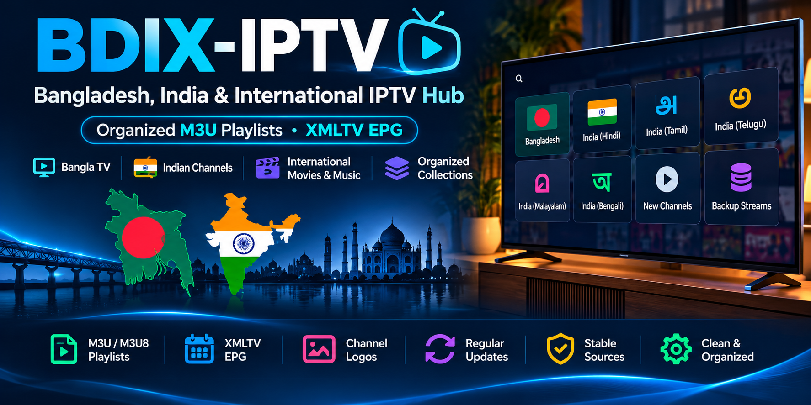

<h1 align="center">BDIX IPTV: Multi-Country M3U Playlists with XMLTV EPG</h1>

<p align="center">
  <strong>A complete, organized multi-country IPTV collection (M3U/M3U8) covering Bangladesh, India, Pakistan and eligible channels from other countries, supported by channel metadata, locally stored logo assets and an XMLTV TV program guide (EPG).</strong><br>
  <sub>Compatible with XCIPTV, TiviMate, OTT Navigator, IPTV Smarters, VLC, Kodi and other M3U-compatible players.</sub>
</p>

<p align="center">
  <a href="https://saeidrahmanbd.github.io/BDIX-IPTV/">
    
  </a>
</p>

<p align="center">
  <a href="https://github.com/saeidrahmanbd/BDIX-IPTV/stargazers"></a>
  <a href="https://github.com/saeidrahmanbd/BDIX-IPTV/network/members"></a>
  <a href="https://github.com/saeidrahmanbd/BDIX-IPTV/commits/main"></a>
  <a href="LICENSE"></a>
</p>

<p align="center">
  
  
  
  <a href="https://github.com/saeidrahmanbd/BDIX-IPTV/actions/workflows/iptv-maintenance.yml"></a>
</p>

<p align="center">
  <a href="https://saeidrahmanbd.github.io/BDIX-IPTV/"><strong>🌐 Project Website</strong></a> &nbsp;·&nbsp;
  <a href="https://saeidrahmanbd.github.io/BDIX-IPTV/playlists.html"><strong>📖 Playlist Guide</strong></a> &nbsp;·&nbsp;
  <a href="https://saeidrahmanbd.github.io/BDIX-IPTV/bangla-iptv.html" lang="bn"><strong>🇧🇩 বাংলা IPTV</strong></a> &nbsp;·&nbsp;
  <a href="#playlists"><strong>📺 Playlists</strong></a> &nbsp;·&nbsp;
  <a href="#epg"><strong>🗓️ EPG</strong></a> &nbsp;·&nbsp;
  <a href="#contact"><strong>📞 Contact</strong></a>
</p>

---

## About BDIX-IPTV

**BDIX-IPTV** is a public collection of organized, multi-country IPTV playlists in M3U/M3U8 format. The main **IPTV-Playlist.m3u** is a broad collection— covering Bangladesh, India, Pakistan, and eligible channels from other countries. The separate **International-Playlist.m3u** provides a companion international collection.

The playlists are maintained with organized channel groups, channel information and locally stored logo assets where available. A shared **XMLTV Electronic Programme Guide (EPG)** is also provided for compatible IPTV players. Automated workflows support channel discovery, playlist maintenance, stream checks and EPG updates.

Stream availability and programme-guide coverage depend on third-party sources and may change over time.

<table align="center">
  <tr>
    <td align="center" width="25%"><h3>🌏</h3><strong>Multi-country</strong><br><sub>Bangladesh, India, Pakistan and more</sub></td>
    <td align="center" width="25%"><h3>📺</h3><strong>Country &amp; genre groups</strong><br><sub>Organized channel collections</sub></td>
    <td align="center" width="25%"><h3>🌍</h3><strong>International</strong><br><sub>Companion international collection</sub></td>
    <td align="center" width="25%"><h3>🗓️</h3><strong>XMLTV EPG</strong><br><sub>TV programme guide</sub></td>
  </tr>
</table>

---

<a id="playlists"></a>
## 📺 Choose Your IPTV Playlist

Choose the collection you want to use. Each playlist is available through a direct M3U URL that you can add to a compatible IPTV player.

<table>
  <tr>
    <td align="center" width="50%" valign="top">
      <h2>🌏</h2>
      <h3>Multi-Country IPTV</h3>
      <p><strong>IPTV-Playlist.m3u</strong></p>
      <p>The main multi-country collection, covering Bangladesh, India, Pakistan and eligible channels from other countries across organized country and genre groups.</p>
      <a href="https://raw.githubusercontent.com/saeidrahmanbd/BDIX-IPTV/main/IPTV-Playlist.m3u">
        
      </a>
      <br><br>
      <a href="https://github.com/saeidrahmanbd/BDIX-IPTV/blob/main/IPTV-Playlist.m3u">View playlist source</a>
    </td>
    <td align="center" width="50%" valign="top">
      <h2>🌍</h2>
      <h3>International IPTV</h3>
      <p><strong>International-Playlist.m3u</strong></p>
      <p>A broader collection featuring Bangladesh and India, alongside eligible movie and music channels from other countries.</p>
      <a href="https://raw.githubusercontent.com/saeidrahmanbd/BDIX-IPTV/main/International-Playlist.m3u">
        
      </a>
      <br><br>
      <a href="https://github.com/saeidrahmanbd/BDIX-IPTV/blob/main/International-Playlist.m3u">View playlist source</a>
    </td>
  </tr>
</table>

### Copy playlist URLs

Use the copy icon at the top-right of each code block to copy the URL.

**Main playlist — Multi-Country IPTV**

```text
https://raw.githubusercontent.com/saeidrahmanbd/BDIX-IPTV/main/IPTV-Playlist.m3u
```

**International companion playlist**

```text
https://raw.githubusercontent.com/saeidrahmanbd/BDIX-IPTV/main/International-Playlist.m3u
```

### 📱 Compatible IPTV Players

The M3U playlists can be used with popular applications that support remote playlist URLs, including:

<p align="center">
  
  
  
  
  
  
</p>

**How to add a playlist:** Copy the M3U URL, open your IPTV player, choose **Add Playlist by URL**, paste the link and refresh the channel list. Menu names may differ between applications.

---

<a id="epg"></a>
## 🗓️ XMLTV EPG – TV Programme Guide

Both playlists use a shared **XMLTV Electronic Programme Guide (EPG)**. Add the following URL in your player's **EPG** or **XMLTV** settings to load programme information for channels with matching schedules.

```text
https://raw.githubusercontent.com/saeidrahmanbd/BDIX-IPTV/main/epg/epg.xml
```

The guide is maintained through an automated process that updates channel mappings, collects available programme schedules and validates the generated XMLTV data before publication. Coverage varies by channel and source availability.

---

## 🖥️ Playlist Studio for Windows

[**Playlist Studio 5.0**](https://github.com/saeidrahmanbd/Playlist-Studio) is a separate Windows application for managing, editing, testing and playing IPTV playlists.

<p align="center">
  <a href="https://github.com/saeidrahmanbd/Playlist-Studio">
    
  </a>
</p>

<p align="center">
  <a href="https://github.com/saeidrahmanbd/Playlist-Studio/releases">
    
  </a>
  <a href="https://github.com/saeidrahmanbd/Playlist-Studio">
    
  </a>
</p>

---

<a id="support"></a>
## 📬 Support

Found a broken stream, incorrect information, a missing logo or another issue?

<p align="center">
  <a href="https://github.com/saeidrahmanbd/BDIX-IPTV/issues"></a>
  <a href="https://github.com/saeidrahmanbd/BDIX-IPTV/discussions"></a>
</p>

> 📝 When reporting a stream issue, include the **channel name, playlist name, stream URL and a short description** whenever possible.

---

<a id="contact"></a>
## 📞 Contact

For collaboration, feedback, IPTV playlist issues or project-related inquiries, contact the maintainer through the channels below.

<p align="center">
  <a href="mailto:saeidrahman.mkt@gmail.com"></a>
  <a href="https://github.com/saeidrahmanbd"></a>
  <a href="https://www.facebook.com/saeid.rahman.sr"></a>
</p>

---

## 📄 License &amp; Disclaimer

The repository's original code and documentation are licensed under the [MIT License](LICENSE), to the extent owned by the maintainer. The license does not cover third-party broadcaster logos, names, trademarks, programme data or stream endpoints; those remain subject to their respective owners' rights.

> ⚠️ This repository does not host television channels, broadcast signals or video content. It provides references to streams and related playlist information. Stream availability and programme data may change without notice. Users are responsible for complying with applicable laws, regulations, broadcaster rights and service terms.

---

<hr>

<p align="center">
  <strong>⭐ If you find this project useful, please consider starring it on GitHub!</strong>
  <br><br>
  <a href="https://github.com/saeidrahmanbd/BDIX-IPTV">
    
  </a>
  <br>
  <sub>Click the badge to visit the repository, then click GitHub's Star button.</sub>
  <br><br>
  <a href="https://github.com/saeidrahmanbd/BDIX-IPTV">
    <strong>github.com/saeidrahmanbd/BDIX-IPTV</strong>
  </a>
  <br><br>
  Developed and maintained with ❤️ by
  <a href="https://github.com/saeidrahmanbd"><strong>Saeid Rahman</strong></a>
</p>
