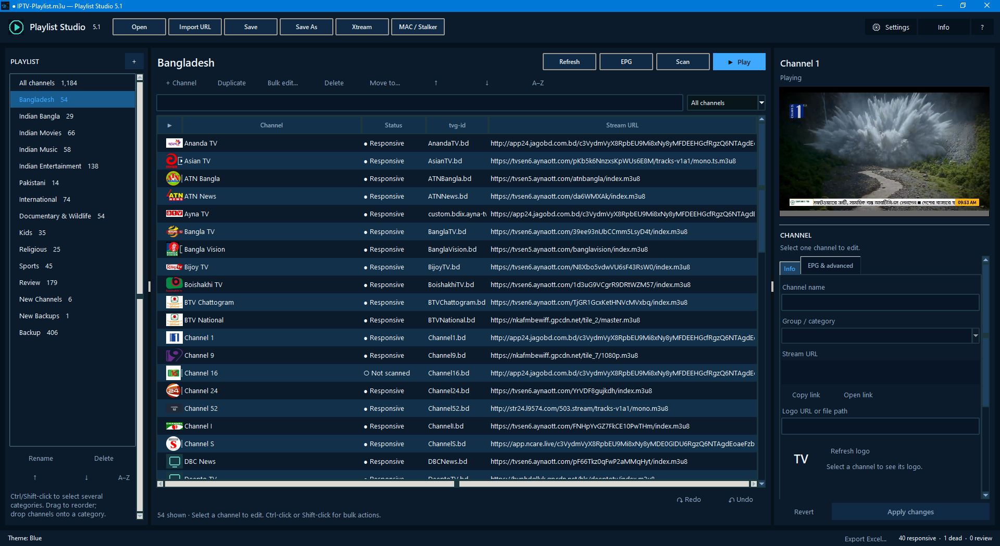

# Playlist Studio 5.1

**Windows Playlist Manager, Editor, EPG Tool & Player**

Playlist Studio 5.1 manages, organizes, edits, tests and plays M3U/M3U8 playlists from one workspace.

## What's new in 5.1

### EPG Centre
- Load multiple XMLTV guides from URLs or local XML, GZ, XZ and ZIP files.
- Review guide coverage by category and source, channel guide statuses and local-time Now / Next with `tvg-shift`.
- Search, sort and edit `tvg-id`; preview bulk metadata changes and undo.
- Manual EPG corrections persist through refresh, re-import and Xtream / Stalker updates.

### Stream scanner
- Statuses: Responsive, Dead, Unreachable, Restricted, Stale, Unavailable, Unverified and Error.
- Timeouts and blocked requests are not automatically classified as Dead.
- Pause, resume and cancel; configure per-server limits, timeouts, retries and player identity.
- HLS freshness checks and optional deep diagnostics; scan selected channels, a category or the current view.
- Good / Bad / Review verdicts, notes and scan history persist between sessions. Export results to Excel or JSON.

### Xtream Codes and MAC / Stalker
- Background login and imports with cancellation.
- Xtream import can fall back to M3U download if the API route fails.
- Stalker / MAC imports can be undone; failed imports leave the playlist untouched.
- Remembered provider logins are protected with Windows DPAPI, not stored in plain text.

### Safer editing, saving and playback
- UTF-8 saving without BOM by default; preserve directives, comments and unknown header keys.
- Repair common malformed channel lines on import.
- Safer backup handling, credential masking, autosave/recovery and Alt+Right / Alt+Left channel shortcuts.

## Download

**Portable application:** [Playlist-Studio-5.1.exe](https://github.com/saeidrahmanbd/BDIX-IPTV/releases/download/v5.1/Playlist-Studio-5.1.exe)

No traditional installation is required. Windows 10/11 x64; VLC playback is bundled.

**Windows Build Kit r2:** [Playlist-Studio-5_1-Windows-Build-Kit-r2.zip](https://github.com/saeidrahmanbd/BDIX-IPTV/releases/download/v5.1/Playlist-Studio-5_1-Windows-Build-Kit-r2.zip)

## Build instructions

Requirements: Windows 10/11 x64 and 64-bit Python 3.10–3.13 (3.13 recommended). Python 3.14/3.15 are not supported by the current pinned PyInstaller dependency set.

1. Download and extract Build Kit r2.
2. Run `BUILD-WINDOWS.cmd`.
3. Wait for **BUILD COMPLETE**.
4. Run `Playlist-Studio-5.1.exe` from the build kit folder.

### Without Python Launcher

The Python Launcher is recommended but optional. Set `PS_PYTHON` to the full path of a compatible Python executable and run the commands in the same Command Prompt window. Adjust paths for your computer:

    set "PS_PYTHON=C:\Program Files\Python313\python.exe"
    cd /d "D:\Software\Playlist-Studio-5_1-Windows-Build-Kit-r2"
    BUILD-WINDOWS.cmd --fresh

`--fresh` recreates `.venv-build`. `PS_PYTHON` applies only to that Command Prompt session. If a build fails, inspect `BUILD-LOG.txt` beside the builder. See the kit's `README.txt` and `KNOWN-LIMITATIONS.md` for details.

## Program glimpse

## Release details

| Item | Details |
|---|---|
| Version | 5.1 |
| Release tag | [v5.1](https://github.com/saeidrahmanbd/BDIX-IPTV/releases/tag/v5.1) |
| Platform | Windows 10 / 11, x64 |
| Edition | Portable |
| Playlist formats | M3U / M3U8 |
| EPG | XMLTV from URLs and local files |
| Playback | Built-in player with bundled VLC |
| Build Python | 3.13 recommended; 3.10–3.13 accepted |

For asset hashes, see [Playlist Studio v5.1 Release Integrity](PLAYLIST-STUDIO-INTEGRITY.md).
